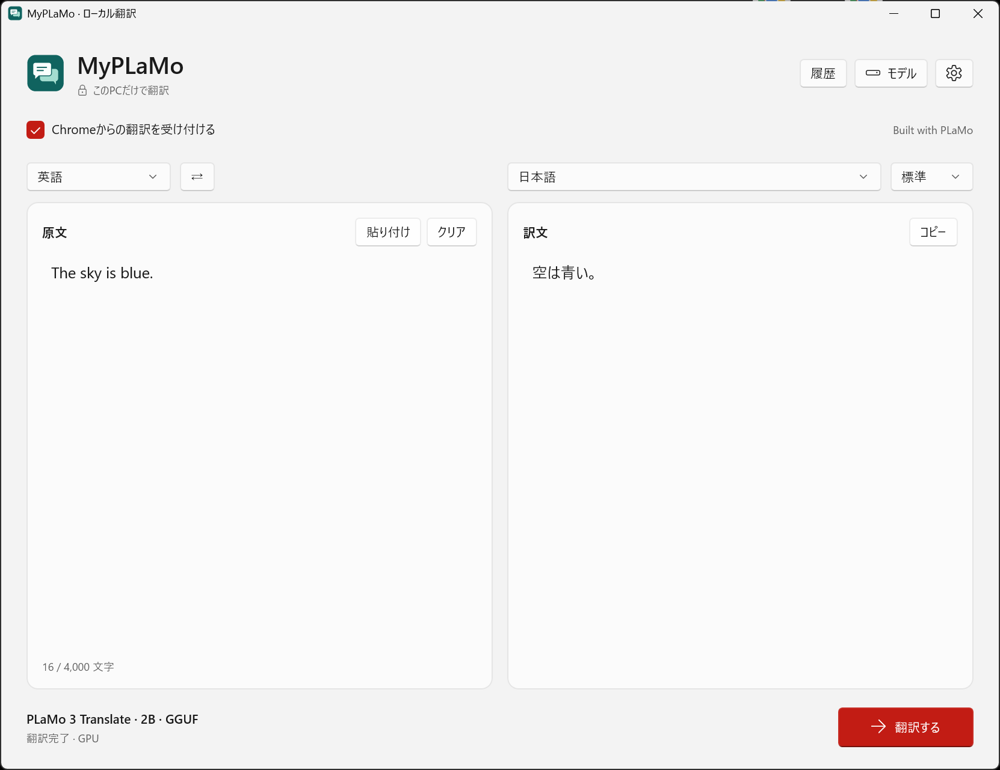
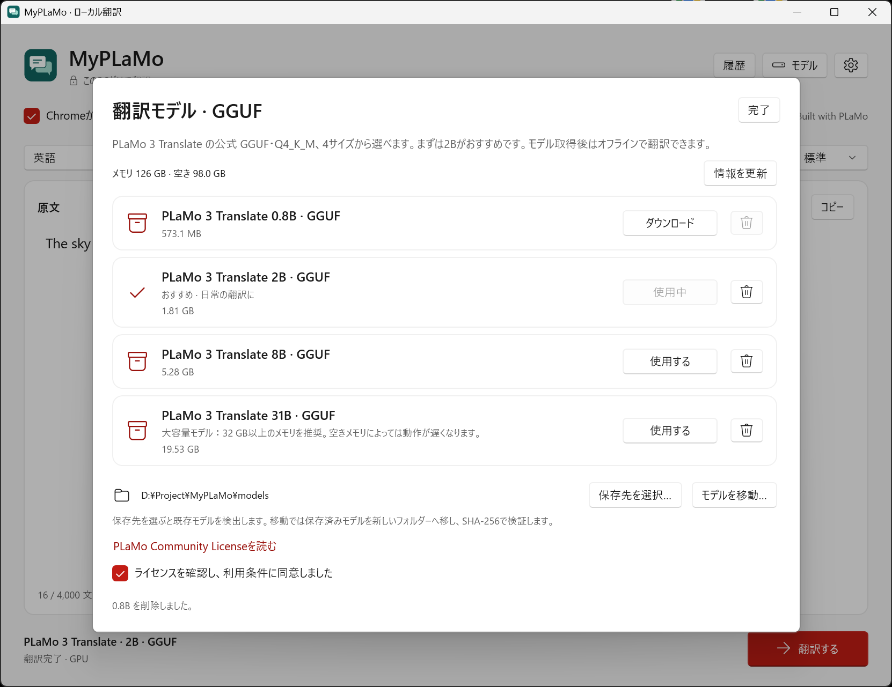

# MyPLaMo

Windows 11 x64 用のローカル翻訳アプリです。WinUI 3 のネイティブ画面で、PLaMo 3 Translate の公式 GGUF（Q4_K_M）を使います。

Built with PLaMo

Mac版は [MyPLaMo for Mac](https://github.com/tkiikt/MyPLaMo-for-Mac)

PFN様のライセンスを侵害しない限り、ご自身で自由に改変して利用していただいて構いません。

**ダウンロード**　[Windows インストーラー](https://github.com/tkiikt/MyPLaMo/releases/latest/download/MyPLaMo-Setup-x64.msi) ・ [ポータブル ZIP](https://github.com/tkiikt/MyPLaMo/releases/latest/download/MyPLaMo-x64.zip)



## はじめに

1. MyPLaMo-Setup-x64.msi を実行し、インストール先を選びます。Windowsの管理者確認が表示された場合は承認してください。完了時の「MyPLaMoを起動する」は初期状態でオンです。ZIP 版はすべて展開して MyPLaMo.exe を起動します。
2. 初回の「モデル」画面で保存先を選び、公式ライセンスに同意して、使用するモデルの「ダウンロード」を押します。取得済みの公式ファイルがある場合はそのフォルダを指定し、「使用する」を押します。
3. SHA-256 の照合とテスト翻訳の完了後、左側に原文を入力し、右側の言語を選んで「翻訳する」または Ctrl + Enter を押します。

## 翻訳モデル

右上の「モデル」から、モデルの取得・切り替え・削除や保存先の変更ができます。まずは2Bがおすすめです。



| モデル | ファイルサイズ | 選び方 |
| --- | ---: | --- |
| 0.8B | 0.57 GB | 少ないメモリで素早く試す |
| 2B | 1.81 GB | 日常使い |
| 8B | 5.28 GB | 品質重視 |
| 31B | 19.53 GB | メモリに余裕のあるPC向け |

GB は10進表記です。推論にはファイルサイズに加え作業用メモリが必要です。設定の「翻訳に使うデバイス」で、自動、CPUのみ、検出された各GPUと計算方式（CUDA／Vulkan）を選べます。

自動では外部GPUを優先し、CUDA、Vulkan、内蔵GPU、CPUの順に利用可能な実行先を試します。CUDA 13.4の実行用ライブラリを同梱しているのでCUDA Toolkitの別途インストールは不要ですが、対応するNVIDIA GPUとドライバーが必要です。CUDAを利用できない環境でもVulkanまたはCPUで実行できます。

GPUを指定した場合、そのGPUと計算方式だけを使用し、利用できなければCPUへ切り替えて画面に理由を表示します。他のGPUには切り替えません。実行中のGPU名とCUDA／Vulkanは、翻訳中・翻訳完了時に画面下部に表示します。GPU一覧は設定を開いたときに取得し、「GPU一覧を更新」で再取得できます。WindowsのタスクマネージャーとエンジンのGPU番号は一致するとは限りません。同名のGPUは一覧で区別しますが、同一型番のカード同士の順序はドライバー変更などで変わる場合があります。

画像生成などに外部GPUのメモリを空けたい場合は「CPUのみ」を選んで保存してください。保存時に読み込み済みモデルを解放します。CPU実行用エンジンはGPU用ライブラリを読み込みません。内蔵GPUも、BIOSで有効になりVulkanドライバーから認識されれば選べますが、CPUのみより速くなるとは限りません。内蔵GPUの共有メモリ量は外部GPUの専用VRAMとは異なります。

**翻訳速度の参考値**（2026年11月9日測定）

Ryzen 9 9950X、GeForce RTX 5090、9950X内蔵のAMD Radeon Graphicsを使い、公式GGUF（Q4_K_M）で一定の英文を敬体の日本語へ翻訳した結果です。モデル読み込み後の3回の翻訳時間の中央値で、モデル読み込み時間は含みません。

| モデル | RTX 5090（CUDA） | RTX 5090（Vulkan） | 9950X（CPU） | AMD内蔵GPU（Vulkan） |
| --- | ---: | ---: | ---: | ---: |
| 0.8B | 0.051 s | 0.047 s | 0.333 s | 0.760 s |
| 2B | 0.085 s | 0.114 s | 1.071 s | 2.268 s |

同じ英文を繰り返す測定のため、入力の計算結果を再利用する推論エンジンのキャッシュが効く場合があります。速度は文章、モデル、GPU、ドライバーなどによって変わります。

「モデルを移動」は、保存済みの全モデルをコピー・検証してから保存先を切り替え、元ファイルを削除します。中断したダウンロードは、同じ保存先とモデルを選んで再開できます。

## 操作

- 自動検出ではモデルが原文を読み取ります。画面に表示する原文の推定言語と入れ替えには Windows のローカル言語判定を使います。短文などで判定が合わないときは翻訳元を指定してください。
- 日本語への翻訳は標準・敬体・常体を選べます。「キャンセル」または Esc で処理を停止します。
- 「文脈を考慮」をオンにすると、直前の段落の原文と訳文を参照しながら翻訳します。「参照する文脈」には分野や状況を任意で入力できます。参照内容は履歴とは別で、アプリを終了すると消えます。
- 「文書形式」は自動判定・テキスト・Markdown・JSON・YAMLから選べます。Markdownの見出し・表・リンク・コード、JSONのキー・数値・真偽値、YAMLのキー・コメント・字下げを保ち、文章の部分を翻訳します。JSON/YAMLのURLやYAMLのタグ・アンカー付き値は保持します。判定が合わない場合は形式を指定してください。構文が壊れているJSON/YAMLはエラーとして表示します。
- 他のアプリで文章を選択して Ctrl + Alt + T を押すと、翻訳画面が開きます。選択文字の取得後にクリップボードを復元します。管理者権限のアプリなど、コピーを受け付けない画面では手動で貼り付けてください。
- 呼び出し元への挿入には「元のアプリに挿入」を使います。確認後に訳文をクリップボードへコピーし、その画面に貼り付けます。
- 閉じるボタンで通知領域に格納します。終了は通知領域の MyPLaMo を右クリックして「終了」を選びます。
- 右上の歯車「設定」で、翻訳に使うデバイス、入力上限、ショートカット、履歴、サインイン時の常駐、テーマを変更できます。テーマは保存後すぐに反映されます。以前の「GPU優先」設定は自動へ、「CPU限定」はCPUのみへ引き継ぎます。
- 設定で履歴を有効にすると最新100件をPC内に保存します。以前の履歴は「履歴」から開いたり全件削除できます。

## 用語集

右上の「用語集」で、用途ごとの用語集を作成・命名・削除できます。原語・訳語・翻訳元・翻訳先を指定して「用語を保存」を押します。登録した用語を選ぶと編集でき、「新しい用語」で次の用語を追加できます。検索にも対応しています。

翻訳画面の「用語集」で使用するものを選びます。用語は翻訳方向が一致し、原文に含まれるものだけモデルへ渡します。自動検出では選択した訳語の言語に対応する用語を参照します。モデルによる翻訳のため、登録した訳語がすべての文章で必ず採用されるわけではありません。

用語集は各5,000語・合計100件まで、原語と訳語はそれぞれ200文字までです。1回の翻訳部分に一致する用語が32語または合計2,000文字を超える場合は、用語集や原文を分けてください。

## Chrome拡張でWebページを日本語に翻訳する

拡張2.3.6では、白ベースの設定メニューを刷新し、本文・操作項目の文字とツールバーのアイコンを見やすくしました。


Chrome拡張「MyPLaMo ページ翻訳」は、本体で選んだモデルを使い、ページの文章をPC内で翻訳します。拡張2.3.6の言語・文体・用語集・文脈の設定にはMyPLaMo 1.4.0以降が必要です。旧本体や旧Mac版では基本の日本語翻訳を利用でき、対応していない設定は更新の案内を表示します。

**ダウンロード**　[MyPLaMo-Web.zip](https://github.com/tkiikt/MyPLaMo/releases/latest/download/MyPLaMo-Web.zip)

**初回設定**

1. MyPLaMo を起動し、画面上部の「Chromeからの翻訳を受け付ける」をオンにします。翻訳中は本体を起動しておいてください。通知領域にしまった状態でも使えます。
2. 拡張機能の配布ファイル `MyPLaMo-Web.zip` を、使い続けるフォルダーに展開します。
3. Chrome のアドレス欄で `chrome://extensions` を開き、「デベロッパー モード」をオンにします。「パッケージ化されていない拡張機能を読み込む」を押し、展開先の **`extension` フォルダー**を選びます。

**ページを翻訳する**　拡張アイコンをクリックすると設定メニューが開きます。原語・訳語・用語集を選び、「このページを翻訳」を押します。右クリックの **「MyPLaMoでWEB全体を翻訳」** からも開始できます。本文・見出し・リンクに加え、後から読み込まれた文章も順に翻訳します。原文に戻すには、ページ右下かメニューの「原文に戻す」を押します。

メニューでは次の設定もできます。

- **自動翻訳**：ページを開いたときに翻訳します。初期状態はオフです。自動翻訳フィルターで除外リストまたは許可リストを選び、現在のページ・サイト・URLパターンを登録できます。`*` は任意の文字列に一致します。手動翻訳はフィルターの対象外です。
- **文体制御**：日本語への翻訳は「です・ます」調が標準です。「だ・である」調にしたいページ・サイトを登録できます。
- **原文表示**：翻訳した文字にマウスを重ねると、その箇所の原文を表示します。余白では表示しません。マウスが離れたときに閉じるか、クリック・Escapeまで残すかを選べます。
- **表示設定**：訳文の改行・折り返しの自動調整、翻訳中の背景色、選択時の翻訳ボタン表示を変更できます。
- **キャッシュ**：保存した翻訳のページ数・容量・期間を確認し、URL検索、ページごとの削除、全件削除ができます。最大100ページ・約6MBで、古いページから削除します。言語・文体・用語集・モデル・本体バージョンが異なる結果は再利用しません。

表示設定は開いているページにも反映されます。言語・用語集・文体を変えた場合は「このページを翻訳」で再翻訳してください。拡張を更新した際は `chrome://extensions` の再読み込みと、Webページの再読み込みを行ってください。

本体が未起動、または「Chromeからの翻訳を受け付ける」がオフのときは、拡張アイコンの右下に黄色い丸の「！」を表示します。設定メニューは未接続でも使えます。接続は約1分ごと、メニューを開いたとき、翻訳するときに確認し、接続が戻ると通常のアイコンに戻ります。

**選択した文章を翻訳**

Webページの文章を選択し、そばに表示されるMyPLaMoアイコンをクリックすると、訳文のポップアップが開きます。上段に接続した本体のバージョンを表示します。右上のクリップボードアイコンで訳文をコピーでき、コピーするとチェックマークに変わります。×・Escape・ポップアップの外側のクリックで閉じられます。

モデルを切り替えるには、本体の「モデル」を開きます。翻訳の対象はWebページ上のテキストです。画像内の文字、PDF、埋め込みフレーム、コード、入力欄は対象外です。

## 保存と通信

設定・用語集・有効にした履歴の保存先は `%LOCALAPPDATA%\MyPLaMo` です。拡張の設定・翻訳キャッシュ（原文、参照する文脈、訳文、URLを含む）はChromeのローカルストレージに保存します。モデルは選んだフォルダに残ります。アンインストール後にも再利用できます。

モデル取得時に Hugging Face に接続します。翻訳時は同梱エンジンが 127.0.0.1 で待ち受け、毎回生成する認証キーでアプリと通信します。原文と訳文はPC内で処理します。

[PFN 公式モデルカード](https://huggingface.co/pfnet/plamo-3-translate-2b-GGUF) ・ [PLaMo Community License](https://plamo.preferredai.jp/info/plamo-community-license-ja) ・ [llama.cpp](https://github.com/ggml-org/llama.cpp/releases/tag/b12121)

## ビルド

ソースからビルドするには、Windows 11 x64、.NET 10 SDK、PowerShell 7 が必要です。リポジトリのルートで次のコマンドを実行します。

```powershell
./build.ps1
```

`release` に本体、ポータブル ZIP、ユーザー単位の MSI、Chrome拡張の ZIP を作成します。Windows App SDK と .NET の実行環境を同梱するため、利用者が個別にランタイムをインストールする必要はありません。モデル本体は配布物に含めません。

## ライセンス

- **MyPLaMo の自作コードとドキュメント**には [MIT License](LICENSE-MIT) が適用されます。
- **PLaMo 3 Translate モデル**には PFN の PLaMo Community License が適用されます。初回設定で利用条件を確認し、選んだモデルを PFN の公式配布元から取得します。個人・非商用利用、商用利用の登録・契約条件、第三者への提供時の表示義務については、[同梱の日本語規約全文（第4条を含む）](LICENSE)をご確認ください。[PFN 公式日本語規約](https://huggingface.co/pfnet/plamo-3-translate-2b-GGUF/blob/main/LICENSE/ja)
- **同梱ソフトウェア**にはそれぞれのライセンスが適用されます。ZIP の展開先または MSI のインストール先の `engine` 以下に llama.cpp、LLVM OpenMP、NVIDIA CUDAのライセンス、`licenses` に .NET、Windows App SDK、MVVM Toolkit、Markdig、YamlDotNet のライセンスと第三者表記があります。
